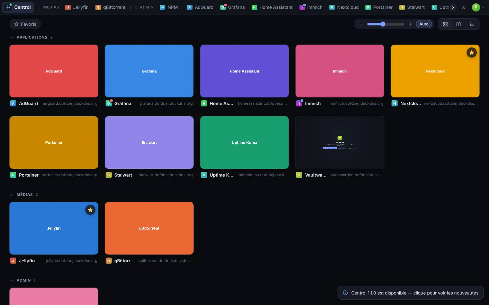
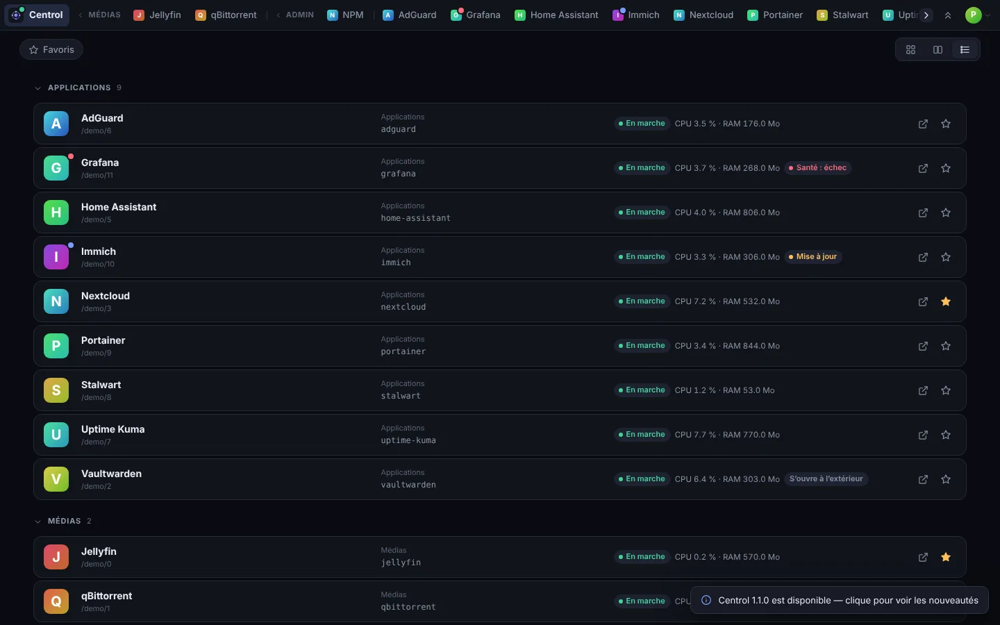
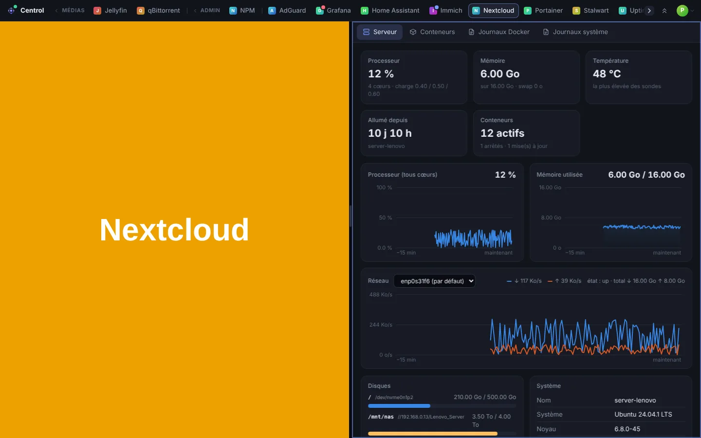
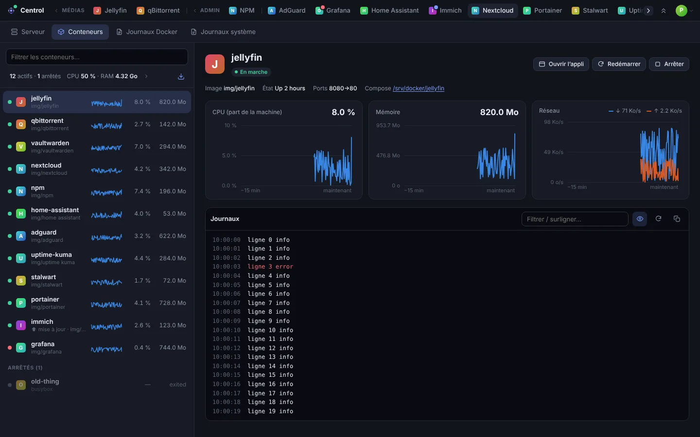
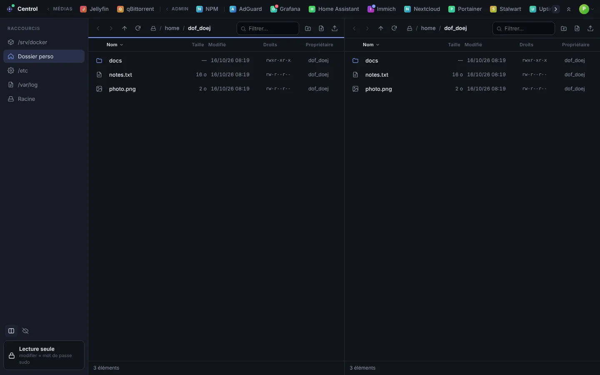
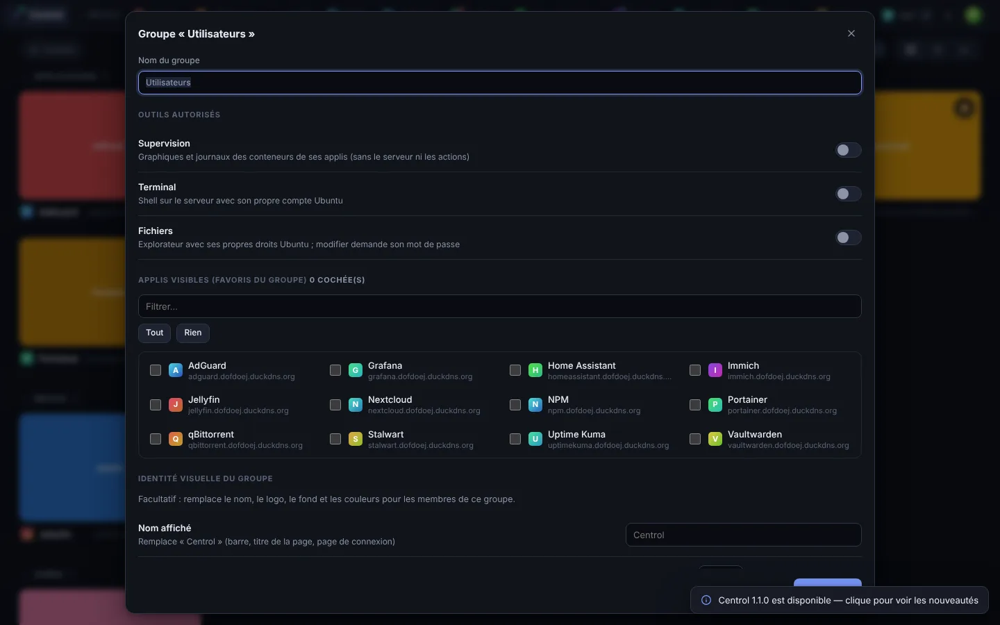
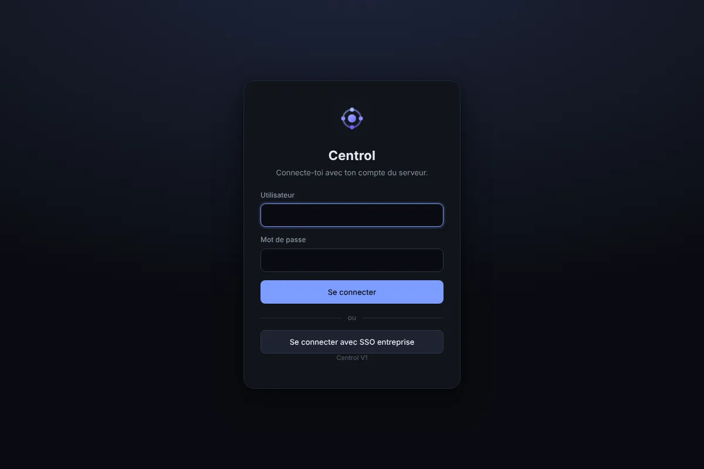

<p align="center">
  
</p>

<h1 align="center">Centrol</h1>

<p align="center">
  <b>Toutes les interfaces web de ton serveur dans une seule fenêtre.</b><br>
  Onglets automatiques depuis Docker et ton proxy (NPM, Traefik, Caddy, Nginx, SWAG) · supervision · terminal · fichiers · comptes et droits.
</p>

<p align="center">
  
  
  
  
</p>

<p align="center"></p>

---

## Sommaire

- [Fonctionnalités](#fonctionnalités)
- [Captures](#captures)
- [Installation](#installation)
- [Mise à jour](#mise-à-jour)
- [Comptes, groupes et droits](#comptes-groupes-et-droits)
- [Relier les applis (connexion unique)](#relier-les-applis-connexion-unique)
- [Intégration des applis](#intégration-des-applis-x-frame-options--csp)
- [Client de bureau](#client-de-bureau-linux--windows)
- [Sécurité](#sécurité)
- [Configuration](#configuration)
- [Développement](#développement)
- [Publier sur GitHub](#publier-sur-github)
- [Licence](#licence)

## Fonctionnalités

**Onglets automatiques**
- Chaque conteneur actif publié par ton proxy devient un onglet, avec son icône ([Dashboard Icons](https://github.com/homarr-labs/dashboard-icons)) et un nom propre (AdGuard, NPM, Nextcloud…).
- Proxys lus : **Nginx Proxy Manager** (sa base), **Traefik** (étiquettes Docker, ou son API pour les routes en fichiers), **Caddy** (Caddyfile, ou son API d'administration), **Nginx** et **SWAG** (fichiers de configuration). Le proxy est détecté à son image Docker ; on peut le choisir à la main dans **Paramètres › Serveurs › Sources des applis**.
- Applis d'autres machines : le proxy de chaque serveur relié par un agent est lu aussi, et chaque appli est rattachée à son conteneur, où qu'il tourne (son nom de machine s'affiche sous la vignette pour les administrateurs).
- Un conteneur s'arrête : son onglet disparaît. Il redémarre : l'onglet revient à sa place.
- Les pages restent ouvertes en arrière-plan : passer d'une appli à l'autre ne recharge rien.
- Onglets personnels : ajoute n'importe quel site, avec son icône récupérée automatiquement.

**Langues**
- Interface en français 🇫🇷 (par défaut), anglais, espagnol, allemand et italien.
- Langue par défaut pour tout le monde, puis par groupe, puis au choix de chacun dans *Paramètres › Apparence*.

**Barre et affichage**
- Barre en haut, en bas, à gauche ou à droite, avec des catégories qui se déplient d'un clic.
- Barre toujours visible, masquée automatiquement ou masquée jusqu'au clic sur une languette discrète : les applis passent en plein écran.
- Vue d'ensemble en 3 affichages :
  - **grille** d'aperçus en direct, de 1 à 6 par ligne ; affichage, taille et filtre favoris dans un petit dock en bas à droite ;
  - vignettes **au survol** par défaut : icône de l'appli, et sa page en direct quand la souris reste dessus (une seule à la fois, zéro lag) ; modes « tout en direct » et « icône seulement » au choix ;
  - **blocs**, plus grands ;
  - **liste**, avec la consommation et l'état de chaque appli.
- Favoris avec une étoile sur chaque vignette, et un filtre « Favoris uniquement ».
- Côte à côte : deux fenêtres l'une à côté de l'autre, séparateur réglable.
- Mode « petite connexion » : les vignettes montrent l'icône au lieu de la page. Rafraîchissement des vignettes réglable.
- Thème clair/sombre et couleurs en hexadécimal.
- Nom, logo et fond d'écran personnalisés, pour tout le monde ou par groupe.
- Recherche rapide `Ctrl+K` et raccourcis clavier pour tout.
- Installable comme application (PWA) ; client de bureau Linux et Windows.

**Supervision** (remplace Dozzle et compagnie)
- Un menu par machine (ce serveur et chaque machine reliée par un agent), avec ses onglets : Serveur, Conteneurs, Processus, Journaux.
- Serveur : CPU, mémoire, température, disques, réseau par interface au choix, avec des graphiques sur 15 min.
- Processus : la liste en direct comme `top` (processeur, mémoire, durée, commande), triable et filtrable ; arrêter un processus de ce serveur (mot de passe sudo).
- Conteneurs :
  - CPU, mémoire et réseau, avec graphiques ;
  - pastilles de santé et de mise à jour d'image disponible ;
  - démarrer, arrêter, redémarrer, mettre à jour, supprimer ;
  - console dans le conteneur (`docker exec`), fiche détaillée (ports, volumes, réseaux, variables, avec les valeurs secrètes masquées) ;
  - **Stacks** : modifier un docker-compose (fichier vérifié, ancien gardé en `.bak`, puis redéployé) ou en créer un dans son propre dossier ;
  - **Ménage** : conteneurs arrêtés, images, réseaux et cache inutilisés (volumes seulement si on les coche), avec l'espace récupéré.
- Journaux Docker en direct, fusionnés ou côte à côte (jusqu'à 4 colonnes), avec filtre, recherche, téléchargement et coloration des lignes JSON et des niveaux (erreur, avertissement…).
- Alertes sur les journaux : un texte ou une expression régulière repéré dans un conteneur prévient les administrateurs dans Centrol et/ou par webhook (ntfy, Gotify, Matrix, Discord, Slack…).
- Autres serveurs : un petit agent en lecture seule (dossier `agent/`) ajoute d'autres machines à la Supervision : leurs conteneurs (statistiques, journaux, alertes) et leur état (processeur, mémoire, disques, réseau), avec une alerte si l'une ne répond plus. On peut les ajouter dès l'installation ou plus tard.
- Journaux système (journalctl) par service et par niveau.

#### Ajouter un autre serveur

Sur l'autre machine (Docker requis), copie le dossier `agent/` de Centrol, puis :

```bash
cd agent && sudo ./install-agent.sh
```

Le script demande l'adresse d'écoute (VPN ou réseau local conseillé) et affiche l'adresse et le jeton à coller dans **Paramètres › Serveurs**. L'agent ne fait que lire : aucune action n'est possible à distance. Ouvre son port (8323) uniquement vers le serveur Centrol.

**Terminal**
- Plusieurs terminaux, côte à côte si besoin.
- Les sessions survivent au rechargement de la page : on retrouve ce qui était affiché. La durée de conservation est réglable.

**Fichiers**
- Double panneau, sélection multiple, glisser-déposer avec confirmation.
- Copier, couper, coller, « Déplacer vers… », « Copier vers… ».
- Propriétés : droits avec cases à cocher et octal, propriétaire, dates, taille d'un dossier.
- Éditeur à onglets avec garde-fous :
  - « Enregistrer les modifications ? » avant de fermer ;
  - détection d'un fichier modifié ailleurs, avec Écraser / Recharger ;
  - lecture seule pour les gros fichiers.
- Envoi avec barre de progression, téléchargement d'un dossier en `.tar.gz`.

**Comptes**
- Connexion avec les **utilisateurs locaux du serveur** (Ubuntu, Debian…), des comptes Centrol, **Kerberos** (Active Directory, FreeIPA, MIT), LDAP ou SSO OpenID Connect (Keycloak, authentik, Entra ID…).
- Double authentification TOTP avec codes de secours.
- Groupes : Administrateurs (tout), groupes standards (outils et applis choisis), Affichage (écran ou kiosque).
- Modérateurs qui gèrent un ou plusieurs groupes.
- Chaque compte a ses propres favoris, catégories, noms, icônes, onglets et réglages.

## Captures

| | |
|---|---|
|  |  |
|  |  |
|  |  |

## Installation

**Prérequis**
- Serveur Linux avec systemd (Ubuntu, Debian, Fedora… ; développé sur Ubuntu 24.04) avec Docker et le plugin compose.
- Un proxy inverse dans Docker : [Nginx Proxy Manager](https://nginxproxymanager.com) (installation guidée par `install.sh`), Traefik, Caddy, Nginx ou SWAG.
- Un utilisateur local du serveur, sudoer, pour administrer Centrol.

```bash
sudo git clone https://github.com/PushPull-Tools/Centrol /srv/docker/centrol
cd /srv/docker/centrol
sudo ./install.sh
```

ou en une ligne :

```bash
curl -fsSL https://raw.githubusercontent.com/PushPull-Tools/Centrol/main/install.sh | sudo bash
```

L'installeur pose ses questions, avec une réponse par défaut pour chacune :
- l'adresse publique de Centrol ;
- le port local ;
- le réseau de NPM ;
- l'utilisateur local administrateur du serveur, dont il vérifie le **mot de passe** sans l'enregistrer.

Il met ensuite en place :

1. `docker_socket_proxy`, un accès **en lecture seule** à l'API Docker, dans son propre dossier ;
2. le groupe Linux `centrol` et une règle sudoers limitée à ce groupe, pour que chacun ouvre terminal et fichiers **avec son propre compte** ;
3. une clé SSH dédiée, acceptée uniquement depuis le réseau Docker de NPM ;
4. en option :
   - un compte « Affichage » (écran) ;
   - le correctif d'intégration NPM (voir plus bas) ;
5. le démarrage de Centrol, suivi d'un auto-diagnostic.

**Dernière étape, dans NPM :** crée l'hôte proxy `centrol.mondomaine.org` vers `http://centrol:8322`, avec **Websockets Support** activé et le SSL.

## Mise à jour

```bash
cd /srv/docker/centrol && sudo ./update.sh
```

`update.sh` récupère la nouvelle version (`git pull`), reconstruit l'image et redémarre Centrol. La configuration (`.env`), les comptes et les réglages de chacun sont conservés.

**Être prévenu :**
- Centrol vérifie deux fois par jour les *Releases* du dépôt et prévient les administrateurs : notification, entrée « Mise à jour disponible » dans le menu, notes de version et commande à copier. Ça se règle dans *Paramètres › Mises à jour*.
- Après chaque mise à jour, une fenêtre « Nouveautés » présente les changements à chaque utilisateur, une seule fois.

**Venir de l'ancien « Central »** (`/srv/docker/central`) : décompresse Centrol dans `/srv/docker/centrol`, puis lance `sudo ./update.sh`. Il :
- reprend données, comptes, catégories et clé SSH ;
- arrête l'ancien conteneur, sans rien effacer ;
- met à jour le correctif NPM.

Il reste à créer le proxy host `centrol` dans NPM.

**Garde-fous :**
- Avant chaque mise à jour, `update.sh` copie les données (comptes, réglages, clé SSH) dans `backups/` ; les 5 dernières copies sont gardées.
- Centrol refuse tout réglage qui empêcherait le dernier administrateur de se connecter (mode de connexion désactivé, compte modifié).
- Arrêter Nginx Proxy Manager demande de taper son nom ; Centrol et le proxy Docker ne peuvent pas être arrêtés depuis l'interface.

**Accès de secours** (mot de passe perdu, 2FA perdue, plus aucun admin) — sur le serveur :

```bash
docker exec -it centrol python -m app.cli useradd secours --source local --group admin
docker exec -it centrol python -m app.cli passwd secours
docker restart centrol
```

Connecte-toi ensuite avec `secours` (compte Centrol, toujours accepté), répare, puis supprime ce compte.

## Comptes, groupes et droits

| Groupe | Outils | Applis visibles | Réglages |
|---|---|---|---|
| **Administrateurs** | Tous, plus la supervision du serveur et les actions sur les conteneurs | Toutes | Tout, y compris les comptes et les groupes |
| **Standard** (ex. Utilisateurs) | Au choix : Supervision, Terminal, Fichiers | Les favoris du groupe | Les siens ; un modérateur règle aussi les groupes qu'il gère |
| **Affichage** | Aucun | Les favoris du groupe | Aucun : idéal pour un écran qui fait tourner une vidéo ou un tableau de bord |

**Terminal et Fichiers**
- Ils s'exécutent avec l'utilisateur local du serveur de la personne, qui doit être membre du groupe `centrol`. Les droits sur les fichiers restent donc ceux du serveur.
- Pour un compte Kerberos, LDAP, SSO ou Centrol, l'administrateur indique quel utilisateur local du serveur utiliser.

**Modifier un fichier ou piloter un conteneur**
- Il faut d'abord déverrouiller le « mode modification » avec son mot de passe.
- Pour un administrateur sudoer, ce mode passe en root. Le mot de passe reste en mémoire 10 minutes, jamais sur disque.

## Relier les applis (connexion unique)

Centrol **permet** de relier les applis à une seule base de comptes, sans rien imposer : chaque brique est désactivée par défaut et indépendante des autres (Paramètres › Authentification › Relier les applis, puis Paramètres › Connexions des applis).

| Brique | Rôle | Quand l'utiliser |
|---|---|---|
| **Sources de comptes** | Comptes du serveur, comptes Centrol, LDAP / Active Directory, Kerberos, fournisseur OIDC externe (Keycloak, authentik, Entra ID…) | Toujours : Centrol consulte la source, il ne recopie jamais les mots de passe |
| **Correspondance des groupes** | Groupe de l'annuaire (memberOf) ou claim OIDC → groupe Centrol, recalculé à chaque connexion | Annuaire d'entreprise avec des groupes |
| **Porte d'entrée** (`/auth/verify`) | Le proxy (Nginx Proxy Manager, Traefik, Caddy) demande à Centrol avant chaque visite d'une appli protégée ; l'appli reçoit `Remote-User`, `Remote-Name`, `Remote-Email`, `Remote-Groups` | Applis sans connexion unique (qBittorrent, AdGuard, *arr…) |
| **Fournisseur OIDC intégré** (`/.well-known/openid-configuration`) | « Se connecter avec Centrol » pour les applis compatibles (Nextcloud, Immich, Portainer, Jellyfin, Vaultwarden, Grafana…) : code + PKCE, jetons RS256, rafraîchissement | Pas d'annuaire ni de Keycloak. Avec un fournisseur d'entreprise, laisse-le désactivé |

- **Assistant par appli :** pour chaque appli détectée, Centrol indique ce qu'elle accepte, crée son client OIDC (adresses de retour proposées, secret affiché une seule fois) et fournit la configuration à coller dans l'hôte NPM.
- **Droits :** une appli n'est accessible (porte d'entrée ou OIDC) qu'aux comptes qui voient son onglet, dans leurs horaires autorisés. Les administrateurs ne sont jamais limités.
- **Secours :** garde le compte administrateur local de chaque appli. Avec la porte d'entrée, si Centrol est arrêté, les applis protégées ne sont plus accessibles par leur adresse : prévois un accès local (IP:port).
- **E-mail :** certaines applis l'exigent (Immich, Vaultwarden) ; il se renseigne dans la fiche du compte, ou vient de l'annuaire / du fournisseur.

## Intégration des applis (X-Frame-Options / CSP)

Beaucoup d'applis (Nextcloud, Vaultwarden…) interdisent d'être affichées dans une autre page. Un seul fichier règle le problème pour toutes : [`extras/npm-server_proxy.conf`](extras/npm-server_proxy.conf), installé par `install.sh` dans `<données NPM>/nginx/custom/server_proxy.conf`.

Ce correctif ouvre l'affichage **uniquement à Centrol** : il retire `X-Frame-Options` et ajoute Centrol à la règle CSP `frame-ancestors`, le reste de la sécurité de chaque appli restant intact. Il est vérifié par `nginx -t`, et annulé automatiquement en cas d'erreur.

## Client de bureau (Linux / Windows)

Deux possibilités :
- **Le plus simple :** dans Chrome ou Edge, ouvre Centrol puis clique sur « Installer » dans la barre d'adresse.
- **Application dédiée :** le dossier [`desktop/`](desktop/) contient un client Electron minimal. Les installateurs (AppImage, .deb, .exe) sont produits par GitHub Actions à chaque version (`git tag v1.0.0 && git push --tags`) et publiés dans *Releases*. Au premier lancement, le client demande l'adresse de Centrol.

## Sécurité

- **Docker :** jamais exposé en écriture. Centrol lit via un proxy en lecture seule ; les actions passent par SSH + `sudo`, avec le mot de passe de l'administrateur.
- **SSH :** la clé de Centrol n'est acceptée que depuis le sous-réseau Docker de NPM (`from=…,restrict,pty`).
- **sudoers :** le compte de service ne peut agir **qu'avec les comptes du groupe `centrol`**, jamais en root sans mot de passe.
- **`/etc/shadow` :** monté en lecture seule, uniquement pour vérifier les mots de passe des utilisateurs locaux.
- **Mots de passe et connexion :** scrypt pour les comptes Centrol, TOTP en option, limitation des essais, cookies `HttpOnly` / `SameSite`, en-tête anti-CSRF, contrôle d'origine du WebSocket.
- **Exposition :** à garder derrière un VPN ou un réseau de confiance, puisque le terminal donne un shell. Voir [SECURITY.md](SECURITY.md).

## Configuration

`install.sh` génère `.env` ; relancer l'installeur suffit à le modifier. Valeurs principales :

| Variable | Rôle | Défaut |
|---|---|---|
| `CENTROL_URL` | Adresse publique (intégration, SSO) | — |
| `CENTROL_PORT` | Port local | `8322` |
| `PROXY_NETWORK` | Réseau Docker de NPM | `npm_network` |
| `SSH_USER` | Utilisateur local de service (administrateur) | — |
| `FS_BOOKMARKS` | Raccourcis de l'explorateur | `/srv/docker,~,/etc,/var/log,/` |

Personnalisation par labels Docker (facultatif) :

```yaml
labels:
  centrol.name: "Médiathèque"
  centrol.icon: "jellyfin"      # nom Dashboard Icons ou URL d'image
```

## Développement

```bash
pip install -r requirements.txt
CENTROL_DATA=./data CENTROL_DEMO=1 uvicorn app.main:app --port 8322
```

- **Backend :** FastAPI.
- **Frontend :** modules JavaScript sans framework ni étape de build, dans `static/js`.
- **Traductions :** le français est la langue source. Chaque texte français sert de clé dans `static/i18n/<langue>.json` (`en`, `es`, `de`, `it`) ; les parties variables s'écrivent `{0}`, `{1}`… Un texte sans traduction s'affiche en français. Tout nouveau texte doit être ajouté aux quatre fichiers.
- **Contribuer :** voir [CONTRIBUTING.md](CONTRIBUTING.md) et [CHANGELOG.md](CHANGELOG.md).

## Publier sur GitHub

```bash
./tools/set-github.sh ton-compte      # remplace OWNER partout
git init -b main && git add . && git commit -m "Centrol V1"
git remote add origin https://github.com/ton-compte/centrol.git && git push -u origin main
git tag v1.0.0 && git push --tags     # publie : image ghcr.io, version, clients de bureau
```

Chaque tag `v*` déclenche :
- **`release.yml` :**
  - image Docker `ghcr.io/ton-compte/centrol` ;
  - page de version avec les notes tirées de `CHANGELOG.md`.
- **`desktop.yml` :** client de bureau Linux et Windows.

À chaque push, `ci.yml` vérifie le code. Dependabot propose les mises à jour des dépendances.

À régler une fois sur GitHub :
- *Settings › General* : description et sujets du dépôt, par exemple `homelab`, `dashboard`, `docker`, `nginx-proxy-manager`, `self-hosted` ;
- *Security › Private vulnerability reporting* : à activer ;
- *Settings › General › Social preview* : y mettre `docs/screenshots/vue-ensemble.webp` ;
- `.github/FUNDING.yml` : ton lien « Buy me a cookie », pour le bouton « Sponsor ».

## Licence

© 2026 Pierre Desenfant. **Code source ouvert, licence non libre :**
- usage personnel et interne autorisé ;
- usage commercial, revente et redistribution de versions modifiées soumis à autorisation.

Voir [LICENSE.md](LICENSE.md). Les logos des applications appartiennent à leurs propriétaires respectifs.

Centrol te fait gagner du temps ? Le bouton « Buy me a cookie » dans *Paramètres › À propos* soutient son développement 🍪
